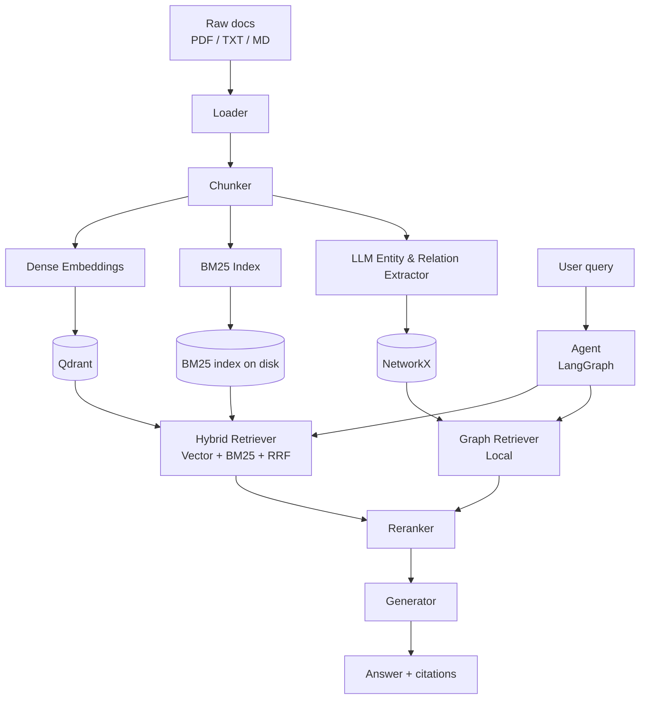

# Hybrid GraphRAG

A modular Retrieval-Augmented Generation (RAG) system that combines **dense vector search**, **BM25 sparse search**, and a **knowledge graph** (local + global search), fused with Reciprocal Rank Fusion (RRF), optionally reranked, and orchestrated by a **LangGraph agent**. Quality is measured with **RAGAS**.

---

## Table of Contents

- [Features](#features)
- [Architecture](#architecture)
- [Project Structure](#project-structure)
- [Prerequisites](#prerequisites)
- [Quick Start](#quick-start)
- [Configuration](#configuration)
- [Usage](#usage)
- [Evaluation](#evaluation)
- [Notebooks](#notebooks)
- [Design Notes](#design-notes)
- [Troubleshooting](#troubleshooting)
- [Roadmap](#roadmap)
- [License](#license)

---

## Features

- **Multi-format ingestion**: PDF, TXT, Markdown (extensible loaders)
- **Hybrid retrieval**: dense embeddings + BM25, merged with RRF
- **GraphRAG**: LLM-based entity/relationship extraction, with *local* (entity-neighbourhood) and *global* (community-summary) search
- **Optional reranker**: cross-encoder reranking for higher precision
- **Agentic layer**: LangGraph agent that routes between vector, keyword, and graph retrieval
- **Evaluation built-in**: golden question set + RAGAS metrics (faithfulness, answer relevancy, context precision/recall)
- **One-command infra**: Qdrant + Neo4j via Docker Compose
- **Centralised config**: every setting lives in `src/config.py` and `.env`

---

## Architecture



**Indexing path:** ingest → chunk → (embed, BM25, graph extraction) → persist
**Query path:** query → retrieve (hybrid + graph) → fuse/rerank → generate

---

## Project Structure

```
hybrid-graphrag/
├── data/
│   ├── raw/                 # Original PDFs, docs, txt
│   ├── processed/           # Cleaned & chunked data (auto-generated)
│   └── evaluation/          # Golden questions + RAGAS results
├── notebooks/               # Learning & experiments
├── src/
│   ├── config.py            # All settings in one place
│   ├── ingestion/           # loader.py, chunker.py
│   ├── indexing/            # embeddings.py, bm25_index.py, vector_store.py
│   ├── graph/               # extractor.py, graph_store.py, graph_rag.py
│   ├── retrieval/           # hybrid_retriever.py, graph_retriever.py, reranker.py
│   ├── generation/          # prompts.py, generator.py
│   ├── agents/              # agent.py (LangGraph)
│   ├── evaluation/          # ragas_eval.py
│   └── pipeline.py          # Orchestration: ingest → index → query
├── scripts/                 # CLI entry points (01–05)
├── docker-compose.yml       # Qdrant + Neo4j
├── .env.example
├── requirements.txt
├── README.md
└── main.py                  # Optional simple entry point
```

---

## Prerequisites

- Python **3.10+**
- Docker & Docker Compose
- An LLM API key (e.g. OpenAI or Anthropic) for graph extraction, generation, and RAGAS
- ~8 GB RAM recommended (more if running local embedding/reranker models)

---

## Quick Start

```bash
# 1. Clone and enter the project
git clone <your-repo-url> hybrid-graphrag
cd hybrid-graphrag

# 2. Create a virtual environment
python -m venv .venv
source .venv/bin/activate          # Windows: .venv\Scripts\activate

# 3. Install dependencies
pip install -r requirements.txt

# 4. Configure environment
cp .env.example .env
# edit .env and add your API keys

# 5. Start Qdrant + Neo4j
docker compose up -d

# 6. Add your documents
cp /path/to/your/files/* data/raw/

# 7. Run the pipeline
python scripts/01_ingest.py
python scripts/02_build_indexes.py
python scripts/03_query.py "What are the main themes in these documents?"
```

---

## Configuration

Secrets and environment-specific values go in `.env`; tunable defaults live in `src/config.py`.

Example `.env`:

```env
# LLM
LLM_PROVIDER=openai
LLM_MODEL=gpt-4o-mini
OPENAI_API_KEY=sk-...
# ANTHROPIC_API_KEY=...

# Embeddings
EMBEDDING_MODEL=BAAI/bge-small-en-v1.5

# Vector store
VECTOR_STORE=qdrant              # qdrant | chroma
QDRANT_URL=http://localhost:6333

# Graph store
GRAPH_STORE=neo4j                # neo4j | networkx
NEO4J_URI=bolt://localhost:7687
NEO4J_USER=neo4j
NEO4J_PASSWORD=change-me

# Retrieval
CHUNK_SIZE=800
CHUNK_OVERLAP=120
TOP_K_VECTOR=20
TOP_K_BM25=20
RRF_K=60
USE_RERANKER=true
RERANKER_MODEL=BAAI/bge-reranker-base
FINAL_TOP_K=5
```

> **Tip:** For quick experiments without Docker, set `VECTOR_STORE=chroma` and `GRAPH_STORE=networkx`.

---

## Usage

| Step | Script | What it does |
|------|--------|--------------|
| 1 | `python scripts/01_ingest.py` | Loads files from `data/raw/`, cleans and chunks them into `data/processed/` |
| 2 | `python scripts/02_build_indexes.py` | Builds the vector index, BM25 index, and knowledge graph |
| 3 | `python scripts/03_query.py "<question>"` | Runs a single query through the retrieval + generation pipeline |
| 4 | `python scripts/04_evaluate.py` | Runs RAGAS over the golden question set |
| 5 | `python scripts/05_run_agent.py` | Starts the interactive LangGraph agent |

### Programmatic use

```python
from src.pipeline import Pipeline

pipe = Pipeline()
pipe.ingest()
pipe.build_indexes()

result = pipe.query("How is X related to Y?", mode="hybrid")   # hybrid | graph | agent
print(result.answer)
for src in result.sources:
    print(src)
```

### Retrieval modes

- **`hybrid`**: dense + BM25 fused with RRF. Best for factual, keyword-sensitive questions.
- **`graph-local`**: entity-centred neighbourhood search. Best for "how are A and B related?"
- **`graph-global`**: community-summary search. Best for "what are the main themes?"
- **`agent`**: LangGraph decides which retrievers to call and can iterate.

---

## Evaluation

Evaluation uses [RAGAS](https://docs.ragas.io/).

1. Create a golden set at `data/evaluation/golden_questions.jsonl`:

   ```json
   {"question": "What is ...?", "ground_truth": "..."}
   ```

2. Run:

   ```bash
   python scripts/04_evaluate.py
   ```

3. Results are written to `data/evaluation/` (per-question scores + aggregate summary).

Tracked metrics: **faithfulness**, **answer relevancy**, **context precision**, **context recall**.

Use it to compare configurations (vector-only vs. hybrid vs. hybrid + graph, with/without reranker) and keep the config that wins on *your* data.

---

## Notebooks

| Notebook | Purpose |
|----------|---------|
| `01_data_exploration.ipynb` | Inspect raw docs, length distributions, quality issues |
| `02_chunking_and_embedding.ipynb` | Experiment with chunk sizes and embedding models |
| `03_graph_building.ipynb` | Test entity extraction prompts, visualise the graph |
| `04_ragas_evaluation.ipynb` | Explore evaluation results and failure cases |

Run them with `jupyter lab` from the project root.

---

## Design Notes

- **Why hybrid?** Dense retrieval captures semantics; BM25 captures exact terms (IDs, names, acronyms). RRF merges them without needing score normalisation.
- **Why a graph?** Vector search struggles with multi-hop and corpus-wide questions. The graph supports relationship traversal (local) and thematic summarisation (global).
- **Why a reranker?** Retrieval is optimised for recall; a cross-encoder improves precision on the final top-k.
- **Why an agent last?** Build and evaluate each layer independently first, then let the agent route between them.

---

## Troubleshooting

| Problem | Fix |
|---------|-----|
| `Connection refused` to Qdrant/Neo4j | Run `docker compose ps`; wait for health checks, then retry |
| Neo4j auth error | Make sure `NEO4J_PASSWORD` in `.env` matches `docker-compose.yml` |
| Graph build is slow/expensive | Test on a small subset of `data/raw/` first; use a cheaper model for extraction |
| Empty retrieval results | Confirm `02_build_indexes.py` completed and the collection name matches `config.py` |
| RAGAS rate-limit errors | Lower concurrency in `ragas_eval.py` or use a smaller evaluation set |

---

## Roadmap

- [ ] Incremental indexing (only new/changed documents)
- [ ] Query rewriting / HyDE
- [ ] Streaming responses and a simple web UI
- [ ] Citation highlighting in answers
- [ ] CI job running RAGAS regression checks

---

## License

This project is licensed under the MIT License - see the LICENSE file for details.